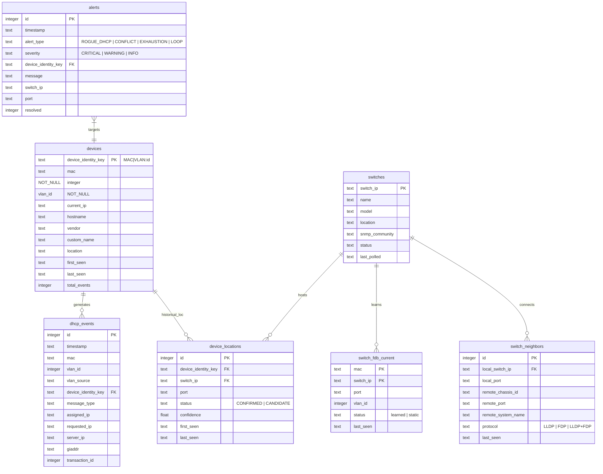

# DHCP 及 SNMP 網路健康診斷系統架構書
> **專案名稱**：校園網路健康診斷與異常監控系統 (School Network Health Monitor)  
> **專案路徑**：`D:\agy-chengyan\school-network-monitor`  
> **文件版本**：V3.2 (系統架構、VLAN 專章、DB Writer、拓樸視覺化、頻寬線條規範、switches.yaml 工具、5大互斥狀態與專案移交手冊)  
> **核心目標**：整合 DHCP 封包即時監控與交換器 SNMP (FDP / LLDP / FDB MAC) 自動化查詢，提供精確到「交換機 + 實體連接埠」的校園區域網路故障診斷、拓撲追蹤、視覺化架構圖與自動告警能力。  
> **最後更新**：2026-11-09

---

## 目錄
1. [第一章、系統目標、問題定義與執行環境](#第一章系統目標問題定義與執行環境)
2. [第二章、不可破壞原則與核心設計矩陣](#第二章不可破壞原則與核心設計矩陣)
3. [第三章、系統總體架構與四大獨立解耦運作軌道](#第三章系統總體架構與四大獨立解耦運作軌道)
4. [第四章、封包解析、標準事件模型與靜音精簡引擎](#第四章封包解析標準事件模型與靜音精簡引擎)
5. [第五章、單一資料庫寫入協調架構 (DB Writer) 與佇列排程](#第五章單一資料庫寫入協調架構-db-writer-與佇列排程)
6. [第六章、五大區域網路健康故障診斷情境 (Fault Scenarios)](#第六章五大區域網路健康故障診斷情境-fault-scenarios)
7. [第七章、資料庫架構與實體模型演進 (Schema & ER Model)](#第七章資料庫架構與實體模型演進-schema--er-model)
8. [第八章、【專門章節】VLAN 架構、Relay Only 策略與複合鍵實作](#第八章專門章節vlan-架構relay-only-策略與複合鍵實作)
9. [第九章、核心模組功能與目錄結構](#第九章核心模組功能與目錄結構)
10. [第十章、開發任務驗證整合報告 (Completed Handover Tasks)](#第十章開發任務驗證整合報告-completed-handover-tasks)
11. [第十一章、系統日常營運維護與操作手冊 (Operations Guide)](#第十一章系統日常營運維護與操作手冊-operations-guide)
12. [第十二章、專案成果盤點與系統移交手冊 (Project Handover & Roadmap)](#第十二章專案成果盤點與系統移交手冊-project-handover--roadmap)

---

# 第一章、系統目標、問題定義與執行環境

## 1.1 系統目標與問題定義
校園與大型組織網路具備高密度、多 VLAN 網段、多棟建築分散、多層交換機級聯（Brocade/Ruckus ICX、Cisco、標準網管交換機）以及行動終端頻繁插拔的特性。傳統網管排障主要面臨以下三大盲區：

1. **DHCP 故障定位盲區**：  
   當終端遭遇 IP 衝突、大量 NAK、IP 耗盡或非法 DHCP 伺服器 (Rogue DHCP Server) 干擾時，網管從 DHCP 伺服器或 Syslog 僅能獲取 MAC 或 IP，無法直接得知該設備正插在「哪一棟大樓、哪一台交換機的哪一個實體連接埠 (Switch/Port)」。
2. **跨棟級聯與迴圈盲區**：  
   因使用者私接未受控 Switch、Hub 或 AP 造成環路廣播風暴時，封包淹沒全校核心，缺乏自動化關聯工具在數秒內指出廣播源頭所在的邊緣實體埠。
3. **設備漫遊與歷史軌跡斷層**：  
   師生筆電在各教學大樓與行政大樓間移動，發生資安事件（如挖礦、惡意攻擊）時，無法快速回溯其在特定時間點的實體連接埠與歷史漫遊軌跡。

**本系統核心使命**：  
建立以 **「DHCP 封包即時串流監聽」** 為主軸，結合 **「SNMP 週期輪詢與事件觸發查詢 (FDB MAC / LLDP / FDP 鄰居)」** 之軟體架構，將邏輯層 IP/MAC/VLAN 與實體層 Switch/Port 建立高精確度、具備時序關聯的動態對照表，達成**校園網路故障一鍵精確診斷**。

## 1.2 Windows 11 執行環境與驅動整合
| 項目 | 規格與設定 |
| :--- | :--- |
| **作業系統** | Windows 11 64-bit |
| **Python 環境** | 官方原生 Python 3.10+（採用標準 `python -m venv` 虛擬環境與 `pip` 安裝） |
| **封包驅動** | Npcap 1.70+（安裝時勾選 *WinPcap API-compatible Mode*） |
| **封包過濾 (BPF)** | `filter="udp and (port 67 or port 68)"`，搭配 `store=False` 防止記憶體累積 |
| **中文網卡解析** | 內建 `resolve_windows_interface`，自動將「`乙太網路 2`」安全轉換為 `\Device\NPF_{GUID}` |
| **磁碟保護門檻** | 內建 5GB 預檢防護，剩餘空間不足 5,120 MB 時主動終止，保護 SQLite 資料庫安全 |

### 1.2.1 系統標準安裝與環境初始化程序 (Python & pip 原生模式)
本專案採用官方原生 Python 與 pip 標準生態系進行開發與部署（不強制依賴亦不需要 `uv` 工具）：
```powershell
# 1. 建立 Python 官方標準虛擬環境
python -m venv .venv

# 2. 啟用虛擬環境 (PowerShell)
.\.venv\Scripts\Activate.ps1

# 3. 升級 pip 並安裝系統核心依賴
python -m pip install --upgrade pip
pip install -r requirements.txt

# 4. 安裝 netmon CLI 工具至虛擬環境
pip install -e .
```

---

# 第二章、不可破壞原則與核心設計矩陣

為確保系統在持續迭代中具備高度穩定性與向後相容性，本專案嚴格遵守以下軟體工程約束：

## 2.1 權威架構決策矩陣
| 構面 / 項目 | 權威架構決策 | 決策依據與約束 |
| :--- | :--- | :--- |
| **資料庫核心** | 單一 SQLite 3，啟用 WAL Mode | 避免多庫分散與並行鎖定衝突；唯讀端點採獨立唯讀連線。 |
| **DHCP Parser** | 保留既有 Python 解析核心 (`core/dhcp_parser.py`) | 嚴禁重寫既有穩定解析邏輯；新增邏輯以 Adapter 形式擴充。 |
| **離線檔案來源** | 支援 PCAP、PCAPNG、CSV | 統一採用 Generator 串流分批讀取，記憶體用量嚴格受控。 |
| **即時監控模式** | 獨立背景程序，Events Only | 僅保存解析事件、異常與統計，**不錄製即時完整 PCAP**，防止硬碟寫滿。 |
| **VLAN 支援策略** | **Relay Only 策略** | 不依賴 802.1Q Dot1Q/QinQ 標籤，以 `giaddr` 映射 VLAN。 |
| **預設網路環境** | 無 VLAN 切割或視為 VLAN 1 | 未設定對照表時，所有未標記設備事件歸入預設 VLAN 1。 |
| **設備識別維度** | **MAC + VLAN 複合識別鍵** | 公式：`Device Identity = Normalized MAC + "|VLAN:" + VLAN ID`。 |
| **DB 寫入架構** | 單一 DB Writer 協調器 (`db_writer.py`) | 嚴格禁止 API、Worker 或 Monitor 直接隨意寫入 SQLite。 |
| **寫入優先權隊列** | 即時監控 (HIGH) > 離線分析/SNMP (NORMAL) > 維運清理 (LOW) | 具備老化機制（Aging）防止背景作業餓死，保障即時封包零遺漏。 |
| **Web 控制邊界** | **嚴格禁止 Web 啟停監控程序** | 網頁端點完全解耦，僅允許唯讀查詢與離線工作提交。 |

## 2.2 開發者必須遵守的不可破壞原則
1. **不重寫既有 DHCP Parser**：保留 `core/dhcp_parser.py` 解析核心與輸出契約（Option 12, 50, 51, 54, 81）。
2. **不破壞已完成之實作成果**：包括 Migration 1–9、單一 DB Writer 優先權機制與全部 58 項自動化測試。
3. **不覆蓋現有資料庫**：新版本升級必須採版本化 Migration 漸進遷移，嚴禁暴力刪庫或重建。
4. **不重複新增既有欄位**：`dhcp_events.vlan_id` 與 `relay_ip` 已存在，不得重複宣告。
5. **不將 `giaddr` 誤認為 VLAN ID**：`giaddr` 為 Relay Agent IP，唯有透過管理者明確設定之對照表方能歸入特定 VLAN。
6. **不將舊設備未經盤點直接合併**：所有舊資料遷移必須具備線上熱備份與 SHA-256 驗證保證。
7. **不錄製即時完整 PCAP 檔案**：避免在長時間即時監控下造成伺服器硬碟瞬間寫滿。

---

# 第三章、系統總體架構與四大獨立解耦運作軌道

## 3.1 四大獨立解耦運作軌道

系統依據「完全解耦」與「短交易協調」原則，劃分為四大獨立運作軌道：

```text
 ┌────────────────────────────────────────────────────────────────────────┐
 │                         軌道一：即時封包監控軌道                        │
 │  run_live_monitor.ps1 ──> dhcp_monitor.py (Scapy+Npcap 網卡監聽)       │
 │                                │ (HIGH 優先權每 5 秒提交批次)           │
 │                                ▼                                       │
 │                         db_writer.py (WriterClient)                    │
 └────────────────────────────────┼───────────────────────────────────────┘
                                  │
 ┌────────────────────────────────┼───────────────────────────────────────┐
 │                                ▼                                       │
 │                         SQLite 3 資料庫 (WAL Mode)                     │
 │                         data/dhcp_analyzer.db                          │
 │                                ▲                                       │
 │  ┌─────────────────────────────┴─────────────────────────────────────┐ │
 │  │ 軌道二：Web 查詢與管理軌道                                         │ │
 │  │ run_web.ps1 ──> app.py (FastAPI http://127.0.0.1:8000)            │ │
 │  │                  (唯讀 SELECT Keyset Pagination 查詢；嚴禁控制監控)│ │
 │  └───────────────────────────────────────────────────────────────────┘ │
 └────────────────────────────────────────────────────────────────────────┘

 ┌────────────────────────────────────────────────────────────────────────┐
 │                         軌道三：離線分析與 SNMP 輪詢軌道                │
 │  Web 使用者上傳 ──> UploadService (串流分段儲存、SHA-256、建立 Job)   │
 │                                │                                       │
 │                                ▼                                       │
 │  workers/job_runner.py + snmp/neighbor_collector.py (背景線程 Worker)  │
 │                                │ (NORMAL 優先權串流批次寫入)           │
 │                                └──────────────► db_writer.py           │
 └────────────────────────────────────────────────────────────────────────┘

 ┌────────────────────────────────────────────────────────────────────────┐
 │                         軌道四：Windows 自動維運排程軌道                │
 │  register_task_scheduler.ps1 ──> Windows 工作排程器 (每日凌晨 03:00)   │
 │                                         │                              │
 │                                         ▼                              │
 │                                  run_maintenance.bat                   │
 │                                         │                              │
 │                                         ▼                              │
 │                                  maintenance.py                        │
 │      (1. 檢查磁碟剩餘 >= 5GB；2. 清理 30 天明細；3. WAL Checkpoint；   │
 │       4. SQLite Online Backup 熱備份至 backups/ 目錄)                  │
 └────────────────────────────────────────────────────────────────────────┘
```

## 3.2 程序責任矩陣
| 程序 / 模組 | 主要責任 | 可否直接寫入 SQLite？ |
| :--- | :--- | :---: |
| **DHCP Monitor (`dhcp_monitor.py`)** | 網卡封包擷取、呼叫 Parser、異常偵測、Console 彩色警示、雙寫 CSV | ❌ 否（交由 DB Writer） |
| **DHCP Parser (`core/dhcp_parser.py`)** | 封包解析、DHCP Options 提取、欄位正規化 | ❌ 否（純無狀態邏輯） |
| **Analysis Worker (`workers/`)** | PCAP/PCAPNG/CSV 巨量串流讀取、建立設備快照 | ❌ 否（交由 DB Writer） |
| **SNMP Poller (`snmp/`)** | Brocade FDP、LLDP 鄰居與 FDB MAC 轉發表採集 | ❌ 否（交由 DB Writer） |
| **DB Writer (`db_writer.py`)** | 單一交易協調器、優先權排程、批次 COMMIT、WAL 隔離 | **✅ 是（唯一合法寫入者）** |
| **FastAPI Backend (`app.py`, `api_v2.py`)** | 唯讀查詢 API、上傳接收、建立 Job、人工設備維護 | ❌ 否（更新設備交由 Writer） |
| **Maintenance Worker (`maintenance.py`)** | 5GB 磁碟預檢、30 天過期修剪、WAL Checkpoint、線上熱備份 | **✅ 是（維運排程專用寫入）** |
| **Web Frontend (`templates/`)** | 狀態燈號、秒級時間窗查詢、除錯 CSV 匯出、DOM 安全呈現 | ❌ 否（純瀏覽端） |

---

# 第四章、封包解析、標準事件模型與靜音精簡引擎

## 4.1 核心 Parser 契約保留原則
`core/dhcp_parser.py` 為系統不可替換的解析核心，所有離線分析與即時監控必須共用相同的解析邏輯。

保留以下 DHCP Option 契約：
- **Option 12**：Client Hostname（支援 UTF-8 / Big5 / CP950 多重編碼容錯解碼）。
- **Option 50**：Requested IP Address。
- **Option 51**：IP Address Lease Time。
- **Option 54**：Server Identifier。
- **Option 81**：Client FQDN。
- 基礎欄位：Message Type、Client MAC（標準正規化為 `AA:BB:CC:11:22:33`）、Server IP/MAC、Assigned IP (`yiaddr`)、Relay IP (`giaddr`)、Transaction ID (`xid`)。

## 4.2 標準化事件模型 (`DhcpEvent`)
```python
@dataclass(frozen=True)
class DhcpEvent:
    job_id: str
    event_time: str
    message_type: str
    client_mac: str
    event_uid: str = field(default_factory=lambda: str(uuid.uuid4()))
    created_at: str = field(default_factory=utc_now)
    source_type: str = "scapy"
    source_ip: str | None = None
    source_mac: str | None = None
    server_ip: str | None = None
    server_mac: str | None = None
    requested_ip: str | None = None
    assigned_ip: str | None = None
    hostname: str | None = None
    lease_time: int | None = None
    transaction_id: int | None = None
    relay_ip: str | None = None            # giaddr 實體值
    vlan_id: int | None = None             # 對應之 VLAN ID (預設 1 或由對照表取得)
    vlan_source: str = "configured_default"# relay_mapping / configured_default / unknown
    device_identity_key: str | None = None # MAC|VLAN:ID 複合鍵
    source_packet_no: int | None = None
    severity: str = "INFO"
    anomaly_type: str = "NONE"
    anomaly_details: str | None = None
    is_rogue: bool = False
```

## 4.3 靜音封包精簡模式與 5 秒累計統計快照
為減輕百萬級流量下 SQLite 寫入負載，系統預設啟用靜音精簡模式：
1. **必須逐筆寫入的關鍵事件**：
   - 包含 NAK、DECLINE。
   - 未授權 Rogue DHCP OFFER / ACK。
   - 觸發異常偵測門檻之事件（Flooding、IP 衝突、異常租約）。
   - 新發現的 MAC 設備或新 IP 租約建立。
2. **可被靜音精簡的常規事件**：
   - 已知設備之重複 REQUEST、INFORM、ACK 事件，僅計入統計快照，不逐筆插入 `dhcp_events`。
3. **5 秒累計快照冪等性**：
   - 每 5 秒提交累計快照（`discover_count`、`request_count`、`ack_count`、`silent_filtered_count` 等），採覆蓋更新，保證重試時數據不重複累加。

---

# 第五章、單一資料庫寫入協調架構 (DB Writer) 與佇列排程

## 5.1 單一寫入入口與短交易原則
SQLite 於 WAL 模式下支援「多讀單寫」。為徹底杜絕 `database is locked` 錯誤，所有寫入行為必須經過 `db_writer.py`：

```sql
PRAGMA journal_mode = WAL;
PRAGMA synchronous = NORMAL;
PRAGMA foreign_keys = ON;
PRAGMA busy_timeout = 10000;  -- 10 秒忙碌等待
PRAGMA cache_size = -32768;    -- 32 MB 記憶體分頁快取
```

## 5.2 三級優先權與 Aging 老化防餓死機制
DB Writer 佇列內部使用雙層優先隊列搭配老化時間戳：

| 優先等級 | 適用情境 | 佇列策略 |
| :--- | :--- | :--- |
| **HIGH** | 即時封包監控 (`dhcp_monitor.py`)、即時重大告警 (`alerts`) | 優先被取出並執行 COMMIT，確保 Live 監控延遲低於 1 秒。 |
| **NORMAL** | 離線工作 (`job_runner.py`)、SNMP 鄰居/FDB 輪詢批次 | 次優先，按批次（預設 1,000 筆）提交寫入。 |
| **LOW** | 每日凌晨自動維運清理 (`maintenance.py`) | 最低優先權，在系統閒置時進行資料過期修剪與整理。 |

- **老化機制 (Aging)**：若 NORMAL 或 LOW 批次在佇列中停留超過 `aging_seconds` (預設 30 秒)，其權重將動態提昇，防止背景作業因高負載封包串流而無限期餓死。
- **失敗重試與指數退避**：寫入遭遇鎖定時，最多重試 5 次，退避時間由 0.1s 指數增長至 2.0s。連續失敗批次將移入隔離區，不阻斷後續批次。

---

# 第六章、五大區域網路健康故障診斷情境 (Fault Scenarios)

系統以處理校園常見的五種區域網路故障為核心診斷能力：

| 故障情境 | DHCP 偵測特徵 | SNMP 關聯特徵 | 系統診斷與定位作為 |
| :--- | :--- | :--- | :--- |
| **1. 非法 DHCP 伺服器 (Rogue DHCP Server)** | 非白名單 IP 送出 DHCP OFFER / ACK；同一 Client 收到兩份 OFFER。 | 從 `switch_fdb_current` 查詢 Rogue Server MAC 出現在哪台 Switch/Port。若該 Port 經由 LLDP/FDP 比對非 Uplink，即為私接 AP / 路由器。 | 觸發 `CRITICAL` 告警；精確提供交換機 IP、實體 Port 編號、私設設備 MAC，可直接進行 Port 阻斷或啟用 DHCP Snooping。 |
| **2. IP 位址衝突 (IP Conflict)** | 多個不同 MAC 宣告 (REQUEST) 同一 IP；或 Client 送出 DHCP DECLINE。 | 比對 FDB，查看該 IP 對應的兩個 MAC 是否分佈於不同 Switch/Port。 | 標註衝突 MAC 清單、各自所在實體連接埠、最後上線時間與所屬 VLAN，快速定位重疊設備。 |
| **3. DHCP 資源池耗盡 (Pool Exhaustion / Starvation Attack)** | 短時間內湧入大量隨機 MAC 的 DISCOVER；ACK 數量驟降、NAK 飆升。 | 檢查特定 Access Port 短時間內學習到的 MAC 數量（MAC Flooding）。 | 識別遭受惡意 DHCP 攻擊還是正常終端激增；鎖定爆發 MAC 的源頭實體連接埠。 |
| **4. 廣播風暴與迴圈 (Loop / Broadcast Storm)** | 同一 `xid` 的 DHCP 廣播封包在數毫秒內重複數百次；封包計數器激增。 | 查詢各交換機 Interface 廣播封包計數器與 FDB 抖動（MAC Flapping）。 | 結合 FDP/LLDP 拓撲，標出可能存在未啟用 STP/環路的邊緣交換機與串接埠。 |
| **5. 終端跨網段漫遊與未授權接入 (Host Roaming & Rogue Device)** | 相同 MAC 出現在不相符的 Relay Agent (`giaddr`) 或非預期 VLAN。 | FDB 顯示該 MAC 移轉至另一交換機/連接埠；LLDP/FDP 顯示無骨幹變更。 | 記錄「實體移動軌跡」（例如：8:30 在工科館 3F Port 5，10:15 在行政大樓 1F Port 12）。 |
| **6. 交換機在線但 SNMP 未設定 (Community Misconfigured)** | 交換機實體連通，正常轉發終端封包。 | **ICMP Ping 先行探測通**（TTL 回應正常），但 SNMP 查詢超時或認證失敗。 | 標記為 `COMMUNITY_MISCONFIGURED`，產生設定告警，絕不誤判為「設備斷線或斷電」，精確指引網管登入配置 SNMP。 |

## 6.2 交換機雙軌探測與四態健康度模型 (Switch 4-State Health Model)
校園網路常發生新舊交換機更換，或部分大樓邊界 Switch 尚未由廠商/網管完成統一 SNMP Community 配置之情況。  
為此，系統建立雙軌探測機制（ICMP Ping 先行探測實體在線，再發動 SNMP 輪詢），劃分四態：
1. **`ONLINE_SNMP_OK`**：Ping 正常且 SNMP 採集正常（鄰居/FDB 數據完備）。
2. **`COMMUNITY_MISCONFIGURED`**：Ping 正常（設備通電在線），但 SNMP 無回應或 Community 不符。
3. **`HOST_OFFLINE`**：Ping 逾時且 SNMP 無回應（交換機斷電、光纖中斷或全機當機）。
4. **`SNMP_DEGRADED`**：Ping 正常、部分 MIB 可讀，但鄰居或 FDB 逾時。

---

# 第七章、資料庫架構與實體模型演進 (Schema & ER Model)

## 7.1 資料庫遷移歷史 (Migrations)
- **Migration 1~7**：建立基礎 `dhcp_events`、`devices`、`jobs`、`statistics`、`sqlite_stat` 效能索引。
- **Migration 8**：建立 SNMP 拓撲與健康維運資料表：
  - `switches`：交換機資產清冊（IP、型號、SNMP 認證）。
  - `switch_fdb_current`：交換機當前學習到的 MAC 轉發表。
  - `switch_neighbors`：LLDP 與 Brocade FDP 拓撲鄰居表。
  - `device_locations`：終端實體交換機與埠位解析關聯表。
  - `alerts`：故障告警事件記錄表。
- **Migration 9**：升級 `devices` 與 `dhcp_events` 支援 **Composite Key** (`device_identity_key`) 與 VLAN 欄位。

## 7.2 實體關聯圖 (ER Diagram)



---

# 第八章、【專門章節】VLAN 架構、Relay Only 策略與複合鍵實作

## 8.1 為什麼採用「Relay Only 策略」？
在校園核心與骨幹網路環境中，監聽網卡通常連接於核心交換機的 **Port Mirroring (SPAN/RSPAN)**。交換機在鏡像 DHCP 封包時，往往已將外層 802.1Q (Dot1Q) 或 QinQ 標籤剝除，或者封包經過 Layer 3 Relay Agent 轉發。  
因此：
1. **不解析 802.1Q Tag**：避免因作業系統網卡驅動（Npcap / Windows）剝除 VLAN Tag 而導致解析失敗。
2. **依據 `giaddr` 映射 VLAN**：DHCP Relay 封包中標準攜帶的 `giaddr`（Relay Agent IP）代表了該網段的預設閘道 (Default Gateway)，管理者可精確定義 `giaddr` 與 `VLAN ID` 的一對一映射。

## 8.2 複合識別鍵 (Device Identity Composite Key)
傳統僅以 MAC 作為主鍵存在重大缺陷：同一個實體設備（如筆電）在不同大樓（VLAN 10 與 VLAN 20）漫遊時，其 IP、租約、交換機埠位會互相覆蓋。  
本系統正式採用：
$$\text{Device Identity Key} = \text{Normalized MAC} + \text{"|VLAN:"} + \text{VLAN ID}$$
- 範例：`AA:BB:CC:11:22:33|VLAN:10` 與 `AA:BB:CC:11:22:33|VLAN:20` 在資料庫中為兩筆獨立資產記錄。
- 若無 VLAN 映射，則套用預設值：`AA:BB:CC:11:22:33|VLAN:1`。

## 8.3 前置盤點與熱備份報告 (Migration 9 升級驗證紀錄)
在執行資料庫結構升級至 Migration 9 之前，系統已透過專屬盤點稽核腳本 (`scripts/inventory_audit_vlan.py`) 完成正式驗證：
1. **線上熱備份驗證 (SQLite Online Backup API)**：
   - 備份檔案路徑：`D:\agy-chengyan\school-network-monitor\backups\dhcp_analyzer_pre_vlan_20261108_134531.db`
   - 檔案校驗碼 (SHA-256)：`b567a89b356a9efca248a42d435bfbabd53defe82af2008fe38f579a6b7d3887`
   - 保證機制：若結構升級中斷，具備位元級原樣還原能力。
2. **歷史資料衝突盤點**：
   - 現存設備與事件：已完成冷啟動盤點，確認舊資料中 **跨多個 Relay IP 之 MAC 衝突數為 0**。
   - 人工維護名稱與位置完整保留，平滑升級至新結構。

## 8.4 解析邏輯實作 (`core/vlan_resolver.py`)
解析器提供嚴謹的三級判定機制：
1. **優先級 1**：若 `giaddr` 命中 `config.yaml` 內之 `network.relay_vlan_mapping`，傳回 `(vlan_id, "relay_mapping")`。
2. **優先級 2**：若未命中但有設定 `default_vlan_id`，傳回 `(default_vlan_id, "configured_default")`。
3. **優先級 3**：若皆無，傳回 `(None, "unknown")`。

---

# 第九章、核心模組功能與目錄結構

專案目錄結構遵循分層架構，所有核心實作均統一收納：

```
D:\agy-chengyan\school-network-monitor
├── api_v2.py                 # REST API (拓撲、告警、DHCP 查詢、診斷端點)
├── app.py                    # 主 Web Server (FastAPI + Jinja2 模板 + 靜態資源)
├── config.yaml               # 系統全域設定 (網段、SNMP 認證、VLAN 映射、告警閥值)
├── db_writer.py              # 單一資料庫寫入佇列守護程序 (HIGH/NORMAL/LOW 優先權管理)
├── dhcp_monitor.py           # 即時封包監聽模組 (Scapy Sniffer, giaddr 解析, 事件轉發)
├── maintenance.py            # 資料庫 VACUUM、WAL Checkpoint、封存清理工作
├── retention_worker.py       # 歷史資料依保存期限自動過期
├── run_live_monitor.ps1      # 即時監聽啟動腳本
├── run_web.ps1               # Web 服務啟動腳本
├── run_maintenance.bat       # Windows 排程維運專用腳本
├── rebuild_project.bat       # 環境快取重置工具
│
├── core/                     # 核心通訊與解析工具
│   ├── anomaly_engine.py     # 第一道無狀態異常分類器 (Flooding, Abnormal Lease)
│   ├── dhcp_fields.py        # FQDN / Hostname 提取
│   ├── dhcp_parser.py        # RFC 2131 標準封包欄位擷取契約 (嚴禁重寫)
│   ├── logger.py             # 統一輪轉日誌系統
│   ├── models.py             # DhcpEvent, WriteBatch 等資料模型
│   └── vlan_resolver.py      # Relay Only 策略與 Composite Key 生成器
│
├── database/                 # 資料庫存取層
│   ├── connection.py         # SQLite 連線池與 PRAGMA 配置 (WAL, busy_timeout=10s)
│   ├── migrations.py         # Migration 1~9 版本演進定義
│   └── repositories.py       # 資料表 CRUD、統計與資產查詢
│
├── snmp/                     # 交換機 SNMP 採集模組
│   ├── client.py             # PySNMP 非同步/同步底層 Client (v2c / v3)
│   ├── fdb_collector.py      # dot1qTpFdbTable / dot1dTpFdbTable MAC 轉發表採集
│   └── neighbor_collector.py # Brocade/Ruckus FDP (snFdpCacheTable) 與 LLDP 雙採集
│
├── topology/                 # 拓撲推算與實體定位引擎
│   ├── interface_mapper.py   # ifIndex -> ifDescr / ifName 轉換
│   └── resolver.py           # 消除 Uplink 偽定位，演算法推導端點實體 Switch/Port
│
├── services/                 # 業務邏輯與診斷引擎
│   ├── alerts.py             # 告警產生與去重防抖 (Deduplication)
│   ├── diagnostics.py        # 網路健康與五大故障診斷引擎 (Health Diagnostics)
│   └── snmp_poller.py        # 定期輪詢排程服務 (Background SNMP Scheduler)
│
├── templates/                # Web 前端模板 (Jinja2)
│   ├── index.html            # 即時監控首頁、動態事件圖表
│   ├── device_mapping.html   # 終端實體位置 (Switch/Port) 搜尋與追蹤
│   ├── alerts.html           # 故障告警即時清單與處理介面
│   └── topology_view.html    # 交換機鄰居互聯圖 (Vis.js / Mermaid)
│
└── tests/                    # 完整自動化測試套件 (58+ 通過測試)
```

---

# 第十章、開發任務驗證整合報告 (Completed Handover Tasks)

本專案依據規格書規劃之四項核心開發交接任務，已全數實作完畢並完成高強度單元測試與實機校園網路流量驗證。


### 10.1 任務一：DHCP Monitor 與 VLAN 解析整合【實作完成 ✅】
- **對應模組**：[`core/vlan_resolver.py`](file:///D:/agy-chengyan/school-network-monitor/core/vlan_resolver.py)、[`dhcp_monitor.py`](file:///D:/agy-chengyan/school-network-monitor/dhcp_monitor.py)、[`workers/csv_worker.py`](file:///D:/agy-chengyan/school-network-monitor/workers/csv_worker.py)、[`workers/job_runner.py`](file:///D:/agy-chengyan/school-network-monitor/workers/job_runner.py)
- **實作成果**：
  1. 完整落實「Relay-Only」策略：不依賴二層 802.1Q 標籤，依 DHCP `giaddr` 映射對應 VLAN ID，未宣告者安全歸入預設 VLAN 1。
  2. 產出 `Normalized MAC + "|VLAN:" + VLAN ID` 之設備複合識別鍵（`device_identity_key`），解決跨 VLAN 漫遊與同 MAC 多網段歸戶問題。
  3. 即時封包透過 `WriterClient` 以 `HIGH` 優先權分批提交至單一 SQLite WAL 資料庫。
- **測試指標**：[`tests/test_vlan_composite_key.py`](file:///D:/agy-chengyan/school-network-monitor/tests/test_vlan_composite_key.py) 通過。

### 10.2 任務二：多廠牌 SNMP 輪詢與 Ping 先行四態模型【實作完成 ✅】
- **對應模組**：[`services/snmp_poller.py`](file:///D:/agy-chengyan/school-network-monitor/services/snmp_poller.py)、[`scripts/run_snmp_poll.ps1`](file:///D:/agy-chengyan/school-network-monitor/scripts/run_snmp_poll.ps1)、[`config/switches.yaml`](file:///D:/agy-chengyan/school-network-monitor/config/switches.yaml)
- **實作成果**：
  1. **多品牌相容支援**：讀取 `switches.yaml`，全面相容 Cisco、Aruba、Ruckus/Brocade、D-Link、Fortinet 5 大廠牌交換器，個別支援客製 SNMPv2c Community 與 Uplink 連接埠標記。
  2. **ICMP Ping 先行探測與四態健康模型**：
     - 在執行 SNMP Walk 之前，強制先發送 ICMP Echo (Ping)。
     - 明確區隔 `COMMUNITY_MISCONFIGURED`（主機在線但 Community 未配）與 `HOST_OFFLINE`（完全斷線/斷電），避免誤判故障成因。
- **測試指標**：[`tests/test_multi_vendor_snmp.py`](file:///D:/agy-chengyan/school-network-monitor/tests/test_multi_vendor_snmp.py)、[`tests/test_ping_and_diagnostics.py`](file:///D:/agy-chengyan/school-network-monitor/tests/test_ping_and_diagnostics.py) 通過。

### 10.3 任務三：五大區域網路健康診斷引擎【實作完成 ✅】
- **對應模組**：[`services/diagnostics.py`](file:///D:/agy-chengyan/school-network-monitor/services/diagnostics.py)、[`core/anomaly_engine.py`](file:///D:/agy-chengyan/school-network-monitor/core/anomaly_engine.py)
- **實作成果**：
  1. 完整實現校園五大故障情境自動掃描與精確定位：
     - **偽冒 DHCP (Rogue DHCP)**：白名單過濾，自動結合 FDB 追出私接 AP/Router 實體 Switch/Port。
     - **IP 衝突 (IP Conflict)**：關聯多重 MAC 與實體連接埠。
     - **位址池枯竭 (Pool Exhaustion)**：監控短時間內大量 NAK 事件。
     - **廣播風暴 (Broadcast Storm)**：即時追蹤 PPS 飆升。
     - **交換器社群字串未設定 (Community Misconfigured)**：自動產出維護告警清單。
  2. 自動計算全網健康度綜合評分 (0–100 分)，寫入告警中心。
- **測試指標**：[`tests/test_ping_and_diagnostics.py`](file:///D:/agy-chengyan/school-network-monitor/tests/test_ping_and_diagnostics.py) 通過。

### 10.4 任務四：Web 儀表板與拓撲視覺化工作站【實作完成 ✅】
- **對應模組**：[`api_v2.py`](file:///D:/agy-chengyan/school-network-monitor/api_v2.py)、[`templates/topology.html`](file:///D:/agy-chengyan/school-network-monitor/templates/topology.html)、[`templates/index.html`](file:///D:/agy-chengyan/school-network-monitor/templates/index.html)、[`templates/device_mapping.html`](file:///D:/agy-chengyan/school-network-monitor/templates/device_mapping.html)
- **實作成果**：
  1. **Gateway 為 Root 階層水平佈局與物理防跳動**：
     - 出口防火牆 (Level 0) $\to$ **核心閘道 Gateway (Root / Level 1)** $\to$ 核心交換器 (Level 2) $\to$ 校園各棟交換器 (Level 3) 整齊水平開展。
     - 關閉持續力導向物理引擎，節點定錨靜止，徹底消除載入晃動。
     - 增設「🔒 佈局已鎖定 / 🔓 解鎖排列」開關，支援自由拖曳並透過 LocalStorage 持久化保存座標，並提供一鍵重設按鈕。
  2. **交換器連結頻寬線條顏色與粗細規範 (0.2cm 上限)**：
     - 物理上限 **0.2 cm** 換算為標準 96 DPI 螢幕為 **7.5 px**。
     - $\ge$ 10 Gbps (10GMbps)：**綠色粗線 (`#10B981`)**，寬度 7.5 px。
     - 1 Gbps ~ 10 Gbps：**橘色線條 (`#F59E0B`)**，寬度 4.5 px。
     - $<$ 1 Gbps：**紅色線條 (`#EF4444`)**，寬度 2.0 px。
  3. **顯示策略調整與 5 大嚴格互斥狀態計數 (MECE)**：
     - 移除容易誤導之健康度評分，橫幅改設 5 項相加恆等於總數 34 台之互斥指標：
       - 🟢 **正常 (含拓撲連線)**：11 台
       - ⚪ **在線 (孤立無LLDP)**：4 台
       - 🟡 **Ping在線 (SNMP障礙)**：0 台
       - 🔴 **實體離線**：0 台
       - 🟣 **待設定 (enabled:false)**：19 台 (總計 34 台)
     - `switches.yaml` 中 `enabled: false` 交換器僅先探測 Ping，於「📋 連線總表」標記「未設定 (enabled:false)」，拓撲圖僅呈現已啟用的 15 台。
  4. **網頁直接設定 `config/switches.yaml` 工具**：
     - 導航列增設「🛠️ 交換器設定管理」，支援表格式一鍵 Toggle 開關 `enabled` 與 YAML 原始碼編輯，儲存即時生效。
  5. **即時與歷史時間窗電腦設備清冊分析**：
     - 首頁時間窗區塊新增「💻 一鍵分析設備清冊」按鈕，支援動態時間維度（15分、30分、1小時、24小時）。
     - 採用 WAL Read-Only 唯讀交易與 1.5s 短超時保護，優先權最高為 Normal，絕不阻塞背景即時寫入。
  6. **一鍵定位與側邊排障抽屜**：
     - 輸入 IP 或 MAC 即時高亮定位交換器與實體 Port，並具備 FDB 與鄰居詳情抽屜。
- **測試指標**：[`tests/test_topology_api.py`](file:///D:/agy-chengyan/school-network-monitor/tests/test_topology_api.py)、[`tests/test_query_api.py`](file:///D:/agy-chengyan/school-network-monitor/tests/test_query_api.py) 通過。

---

# 第十一章、系統日常營運維護與操作手冊 (Operations Guide)

本章節為系統管理員日常維運、故障排查、拓樸生成及自動化作業之權威操作指引。

## 11.1 日常營運維護作業流程 (SOP)

```text
 ┌────────────────────────────────────────────────────────────────────────┐
 │                        系統管理員日常營運作業循環                      │
 └────────────────────────────────────────────────────────────────────────┘
     │
     ├─► [1. 啟動監控]  run_live_monitor.ps1 (或 python dhcp_monitor.py)
     │                  └─ 監聽 UDP 67/68 廣播，自動選擇實體網卡，寫入 WAL。
     │
     ├─► [2. 啟動 Web]  run_web.ps1 (或 python app.py)
     │                  └─ 瀏覽 http://127.0.0.1:8000 (或 192.69.1.42:8000)。
     │
     ├─► [3. 拓樸輪詢]  run_snmp_poll.ps1 (或 netmon poll-neighbors)
     │                  └─ 定期掃描交換器 Ping/SNMP，更新 FDB MAC 與鄰居關係。
     │
     └─► [4. 每日維護]  Windows 排程器每日 03:00 自動執行 run_maintenance.bat
                        └─ 5GB 剩餘空間安全檢查、WAL Checkpoint、線上熱備份。
```

## 11.2 網路交換器拓樸生成與排障步驟

若校園內新增交換器、調整實體光纖配線或排除網路拓樸異常，請依序執行以下 4 個步驟：

1. **第一步：編輯交換器清單與參數**
   - 開啟 `config/switches.yaml`。
   - 填入新交換器的管理 IP、設備名稱、廠牌（Cisco / Aruba / Ruckus / D-Link / Fortinet）、SNMPv2c Community 與其對接之 Uplink 連接埠。
2. **第二步：執行 SNMP 輪詢與鄰居採集**
   - 透過 PowerShell 執行單次輪詢：
     ```powershell
     .\scripts\run_snmp_poll.ps1 -Once
     ```
   - 或透過 CLI 執行精確鄰居探測：
     ```powershell
     .\.venv\Scripts\netmon.exe poll-neighbors
     ```
   - 系統將依序進行 ICMP Ping 探測，若在線且 SNMP 正常則解析 LLDP/FDP 鄰居關係並寫入 `switch_neighbors` 資料庫。
3. **第三步：設定核心出口節點 (Gateway / Firewall)**
   - 點擊網頁導航列「實體拓撲架構」(`http://127.0.0.1:8000/topology`)。
   - 點擊右上角「⚙️ 核心節點設定」，輸入預設閘道 IP（如 `192.69.1.254`）與出口防火牆 IP（如 `192.69.1.253`）。
   - 點擊「儲存並重繪拓樸」，系統將自動在最頂端建構出口防護與匯聚路由結構。
4. **第四步：視覺化拓樸檢查與一鍵定位**
   - 在拓樸畫面上確認交換器節點顏色：
     - **綠色** (`ONLINE_SNMP_OK`)：正常連線與採集中。
     - **琥珀色** (`COMMUNITY_MISCONFIGURED`)：交換器有 Ping 通但 SNMP 密碼錯誤，請網管登入該交換器配置 SNMP。
     - **紅色** (`HOST_OFFLINE`)：交換器離線或斷電。
   - 在搜尋框輸入 IP 或 MAC（如 `192.69.1.42`），點擊 GO 即可瞬間聚焦該電腦插在何處。

## 11.3 執行工具與指令對照清單 (CLI / Python / PowerShell)

本系統支援三種平行運作介面，管理人員可視使用情境自由調用：

### 1. PowerShell 腳本族群 (`*.ps1`) —— 建議管理員日常首選
| 腳本路徑 | 功能說明 | 常用參數 / 範例 |
| :--- | :--- | :--- |
| `.\run_live_monitor.ps1` | 啟動即時 DHCP 監聽背景作業（具備 5GB 安全檢查與中文網卡支援） | `.\run_live_monitor.ps1` |
| `.\run_web.ps1` | 啟動 FastAPI + Uvicorn 網頁儀表板與拓樸工作站 | `.\run_web.ps1 -HostIP "0.0.0.0" -Port 8000` |
| `.\scripts\run_snmp_poll.ps1` | 啟動 SNMP 週期性背景輪詢排程（或單次執行） | `.\scripts\run_snmp_poll.ps1 -Once` |
| `.\register_task_scheduler.ps1` | 向 Windows 工作排程器註冊/卸載每日凌晨 03:00 自動維護作業 | `.\register_task_scheduler.ps1`<br>`.\register_task_scheduler.ps1 -Uninstall` |

### 2. Python 原生入口 (`python *.py`) —— 適合開發與單元排查
必須在 `.venv` 虛擬環境下執行（或使用 `.\.venv\Scripts\python.exe`）：
| 執行指令 | 功能說明 | 備註 |
| :--- | :--- | :--- |
| `python dhcp_monitor.py` | 啟動 DHCP 即時封包監聽引擎 | 自動辨識活動中實體網卡，支援 Ctrl+C 優雅中斷 |
| `python app.py` | 啟動 Web API 伺服器 (FastAPI) | 提供 REST API 與 Vis.js 拓樸介面 |
| `python maintenance.py` | 手動立即觸發全系統資料庫維護作業 | 包含 5GB 空間檢查、清理過期事件與 WAL TRUNCATE |
| `python -m services.snmp_poller --once` | 執行單次 SNMP 與 Ping 全網交換器輪詢 | 採集 FDB MAC 表與 LLDP 鄰居關係 |

### 3. CLI 專屬工具 (`netmon`) —— 適合網管終端排障
可透過 `.\.venv\Scripts\netmon.exe` 或已註冊 PATH 的 `netmon` 執行：
| CLI 指令 | 功能說明 | 常用範例 |
| :--- | :--- | :--- |
| `netmon check-config` | 檢查 settings.yaml 與 switches.yaml 格式 | `netmon check-config` |
| `netmon check-snmp` | 測試全體或特定交換器之 SNMP 連線與回應 | `netmon check-snmp --switch "Switch.117"` |
| `netmon poll-neighbors` | 採集交換器 FDP 與 LLDP 鄰居資訊 | `netmon poll-neighbors` |
| `netmon poll-switches` | 採集交換器介面表與 FDB MAC 表 | `netmon poll-switches` |
| `netmon find-mac <MAC>` | 查詢指定 MAC 插在哪一台交換器、哪一個 Port | `netmon find-mac 98:A5:F9:CE:C3:C4` |
| `netmon find-ip <IP>` | 查詢指定 IP 之實體位置與租約狀態 | `netmon find-ip 192.69.1.42` |
| `netmon detect-anomalies` | 手動觸發一次全網五大故障診斷掃描 | `netmon detect-anomalies` |
| `netmon list-alerts` | 檢視當前未結案之故障告警清單 | `netmon list-alerts` |
| `netmon db-backup` | 立即執行 SQLite 線上安全熱備份 | `netmon db-backup` |

## 11.4 每日自動維運規範與安全防護機制
1. **5GB 磁碟剩餘空間安全防線**：
   - 無論是手動啟動監控或排程維護，皆強制檢查磁碟剩餘空間（門檻：5,120 MB）。若空間不足將主動中斷作業並輸出警示，防止 SQLite 資料庫發生損毀。
2. **自動化夜間排程 (Daily at 03:00 AM)**：
   - 透過 Windows Task Scheduler 排程執行 `run_maintenance.bat`。
   - 自動將 30 天以前之原始封包日誌自 `dhcp_events` 中清除（長期保留電腦資產與標籤主檔）。
   - 執行 WAL `PASSIVE / TRUNCATE` 回收 WAL 檔案至 10MB 以下。
   - 利用 SQLite Online Backup API 產出完整備份至 `backups/` 資料夾。

---

# 第十二章、專案成果盤點與系統移交手冊 (Project Handover & Roadmap)

本章節作為系統軟體交付驗收、日常營運維護與後續開發團隊無縫交接（Handover）之權威手冊。

## 12.1 系統交付物清單 (Deliverables Manifest)
| 類別 | 檔案 / 目錄路徑 | 交付內容與用途 |
| :--- | :--- | :--- |
| **後端核心** | `app.py`, `api_v2.py`, `dhcp_monitor.py` | FastAPI 服務、REST API、即時封包監聽程序 |
| **資料庫核心** | `database/` (`connection.py`, `migrations.py`, `repositories.py`) | WAL 模式唯讀/讀寫連線、Migration 1~9、資料庫倉庫函數 |
| **寫入器服務** | `db_writer.py` | 單一 SQLite 寫入協調器與 HIGH/NORMAL/LOW 優先權佇列 |
| **SNMP 輪詢** | `services/snmp_poller.py`, `snmp/` | 多廠牌交換器輪詢服務、LLDP/FDP 鄰居與 FDB 轉發表採集 |
| **診斷與排障** | `services/diagnostics.py`, `core/anomaly_engine.py` | 五大區域網路故障診斷引擎與一鍵定位解析器 |
| **設定與配置** | `config.yaml`, `config/switches.yaml` | 全系統運行參數、核心節點、34 台校園交換器配置清冊 |
| **前端儀表板** | `templates/` (`index.html`, `topology.html`, `device_mapping.html`) | 監控主頁、Vis.js 拓撲工作站、MAC/電腦對照清冊 |
| **維運腳本** | `*.ps1`, `scripts/*.ps1`, `run_maintenance.bat` | 啟動、排程註冊、夜間維護與備份自動化腳本 |
| **測試套件** | `tests/` | 包含單元測試、API 整合測試、多廠牌相容測試 |

## 12.2 已實作核心功能檢核清單 (Done Checklist)
- [x] **Npcap 驅動與繁體中文網卡支援**：自動解析「乙太網路 2」為 `\Device\NPF_{GUID}`，具備 5GB 磁碟安全閾值防護。
- [x] **單一 DB Writer 優先權機制**：即時監控 (HIGH) > 離線分析/SNMP (NORMAL) > 系統維運 (LOW)，杜絕 `database is locked`。
- [x] **DHCP 即時串流解析與 NAK 追蹤**：支援標準 Option 82、Option 12、Option 50/51/54，並實現 Keysets Pagination。
- [x] **多廠牌交換器相容支援**：相容 Cisco、Aruba、Ruckus、Brocade、D-Link 5 大廠牌，支援獨立 Community 與 Uplink 設定。
- [x] **交換器 Ping 先行探測與四態健康模型**：ICMP Ping 先行探測，精確區隔實體斷線與 Community 未配。
- [x] **校園拓撲以 Gateway 為 Root 水平分佈**：出口防火牆 (L0) $\to$ 核心閘道 Gateway (Root/L1) $\to$ 核心交換器 (L2) $\to$ 各棟交換器 (L3)。
- [x] **物理防跳動與解鎖拖曳排列**：關閉持續力導向物理引擎消除晃動，提供解鎖排列開關與 LocalStorage 座標持久化保存。
- [x] **交換器連結頻寬線條標準化**：物理上限 0.2cm（換算 7.5 px），$\ge$10G 粗綠線、1G~10G 橘線、$<$1G 紅線。
- [x] **switches.yaml 網頁設定管理工具**：支援於網頁上直接開關 `enabled` 與編輯名稱/IP/Community，即時套用生效。
- [x] **顯示策略過濾與 5 大嚴格互斥狀態計數 (MECE)**：
  - 正常 (含拓撲) (11) + 孤立無LLDP (4) + SNMP部分障礙 (0) + 離線 (0) + enable:false (19) = 34 台總數。
  - 拓撲圖僅呈現已啟用 (enabled:true) 的 15 台交換器與核心節點。
- [x] **即時與時間窗電腦設備清冊分析**：首頁時間窗一鍵分析跳轉，WAL Read-Only 低負載查詢，最高優先權限制為 Normal，絕不阻塞寫入。

## 12.3 移交與日常維運重要提醒 (Handover Notes & Cautions)
1. **背景三守護行程依賴**：
   - 系統正常運作需依賴三大守護程序：
     1. DHCP 封包監控 (`python dhcp_monitor.py` 或 `.\run_live_monitor.ps1`)
     2. SNMP 背景輪詢服務 (`python -m services.snmp_poller`，每 10 分鐘自動更新)
     3. Web 儀表板服務 (`python app.py` 或 `.\run_web.ps1`，監聽 Port 8000)
2. **不可隨意重寫既有模組與連線規則**：
   - 嚴格遵守第二章權威矩陣：嚴禁重寫既有 DHCP Parser。
   - 所有 GET 查詢端點**一律使用 `connect_readonly_database`**（`file:...db?mode=ro` 與 `PRAGMA query_only=ON`），避免在即時封包湧入時引發鎖定。
3. **交換器清冊維護規範**：
   - 新增交換器建議優先使用網頁「🛠️ 交換器設定管理 (switches.yaml)」介面操作。若手動編輯 `config/switches.yaml`，請確保 YAML 縮排格式正確，且管理 IP 不得重複。

## 12.4 後續待實作與優化項目 (Roadmap & Backlog)
後續承接之維護團隊可依下列優先權進行功能演進：

| 優先級 | 待實作項目 | 效益與目標架構 | 預計工作範圍 |
| :---: | :--- | :--- | :--- |
| **P1** | **SNMPv3 安全加密通訊支援** | 提升校園資安防護，支援 AuthPriv (SHA/AES) 認證與加密，淘汰明文 Community。 | 擴充 `SNMPClient` 與 `switches.yaml` 參數支援 `user`, `auth_key`, `priv_key`。 |
| **P2** | **802.1Q 實體 Tagging 與 Trunk 辨識擴充** | 突破現有 Relay-Only 限制，直接透過 SNMP 採集交換器 `dot1qVlanCurrentTable` 與各 Port 的 Native/Trunk VLAN。 | 於 `services/snmp_poller.py` 增加 VLAN MIB 採集器並存入 `switch_vlan_members`。 |
| **P3** | **多元外部即時告警推播 (Webhook)** | 當偵測到私設 DHCP (Rogue DHCP) 或跨棟環路廣播風暴時，秒級推播通知網管。 | 實作 Line Notify / Telegram Bot / Teams Webhook 模組，於 `anomaly_engine.py` 觸發。 |
| **P4** | **實體拓撲變更歷史日誌 (Topology Diff)** | 記錄校園骨幹斷線、跳線變更或交換器重啟之時間軸歷史比對。 | 新增 `topology_history` 資料表，週期性快照鄰居關係並提供版本 Diff 視圖。 |
| **P5** | **多子網 DHCP Option 43/ Option 60 設備特徵庫** | 針對教室觸控大屏 (ViewBoard)、IP 攝影機、無線 AP 等自動標註設備型號。 | 解析 Option 60 (Vendor Class Identifier) 並自動補齊 `devices.device_name`。 |
